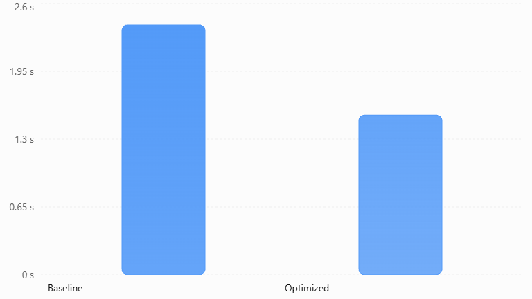
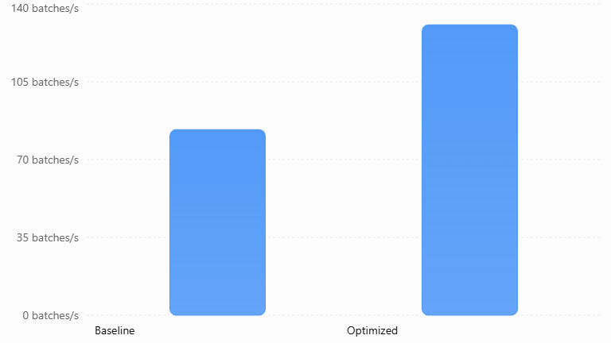
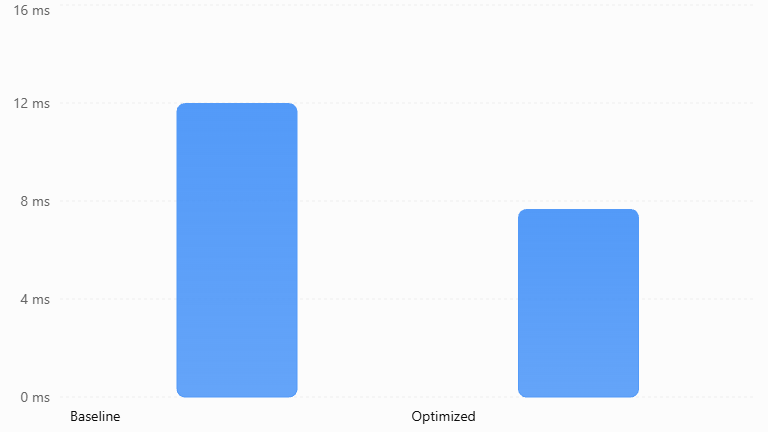
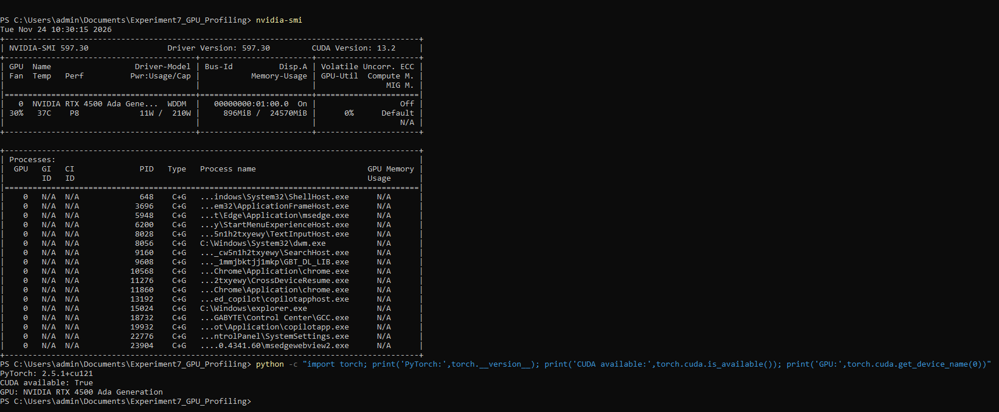
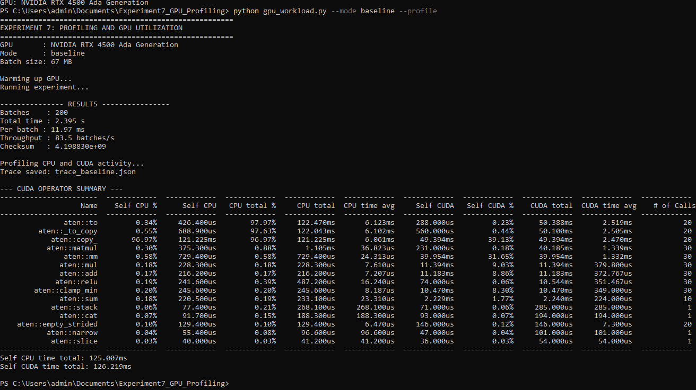
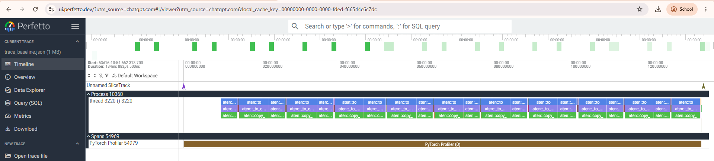
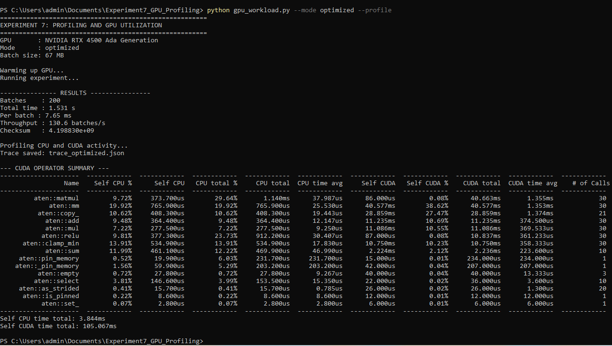
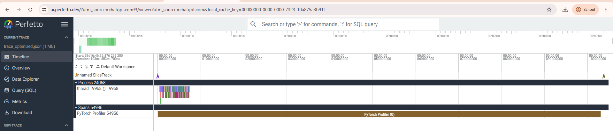

# Experiment 7: GPU Profiling and Utilization Optimization

## Overview

This experiment evaluates GPU performance by comparing a baseline implementation with an optimized implementation on an NVIDIA RTX 4500 Ada Generation GPU.

The experiment focuses on analyzing execution time, throughput, per-batch processing time, and the impact of GPU memory-transfer and execution-scheduling optimizations.

The optimized implementation incorporates:

- Pinned host memory
- Asynchronous memory transfers
- Two CUDA streams
- Double buffering

The objective is to evaluate the performance improvement achieved through these optimization techniques.

---

## Hardware and Software Environment

| Component | Specification |
|---|---|
| GPU | NVIDIA RTX 4500 Ada Generation |
| GPU Architecture | Ada |
| VRAM | 24 GB class |
| Programming Framework | PyTorch |
| PyTorch Version | 2.5.1+cu121 |
| CUDA Availability | True |
| Operating System | Windows |
| Programming Language | Python |

---

## Experiment Configuration

| Parameter | Value |
|---|---:|
| Number of batches | 200 |
| Rows per batch | 16,384 |
| Columns per batch | 1,024 |
| Compute repetitions | 3 |
| Batch data size | Approximately 67 MB |
| GPU | NVIDIA RTX 4500 Ada Generation |

Both baseline and optimized configurations were executed using the same workload parameters for comparison.

---

## Implementations

### Baseline Implementation

The baseline implementation uses:

- Pageable host memory
- Standard host-to-device memory transfers
- Default CUDA stream execution
- Sequential batch processing

It serves as the reference implementation for performance evaluation.

### Optimized Implementation

The optimized implementation incorporates the following techniques:

**Pinned Host Memory**

Page-locked host memory is used to facilitate asynchronous memory transfers between CPU and GPU memory.

**CUDA Streams**

Two CUDA streams are used to separate data-copy operations from computation.

**Double Buffering**

Two GPU buffers are used to allow one buffer to be processed while another is prepared for incoming data.

**Asynchronous Transfers**

Non-blocking memory transfers are used to enable potential overlap between data movement and computation.

These optimizations aim to reduce data-transfer overhead and improve GPU workload scheduling.

---

## Final Performance Results

### Baseline vs Optimized

| Metric | Baseline | Optimized |
|---|---:|---:|
| Total batches | 200 | 200 |
| Total execution time | 2.395 s | 1.531 s |
| Time per batch | 11.975 ms | 7.655 ms |
| Throughput | 83.5 batches/s | 130.6 batches/s |
| Self CUDA time total | 126.219 ms | 105.067 ms |
| Checksum | 4.198830e+09 | 4.198830e+09 |

---

## Performance Improvement

| Metric | Improvement |
|---|---:|
| Speedup | 1.56x |
| Execution time reduction | 36.08% |
| Throughput increase | 56.41% |
| Time saved | 0.864 seconds |
| Output checksum | Matched |

The optimized configuration completed the workload in less time and achieved higher throughput than the baseline in the measured run.

---

## Performance Graphs

### 1. Total Execution Time

Lower execution time indicates better performance.



| Configuration | Execution Time |
|---|---:|
| Baseline | 2.395 seconds |
| Optimized | 1.531 seconds |

The optimized configuration reduced total execution time by approximately 0.864 seconds, representing a 36.08% reduction.

### 2. Throughput Comparison

Higher throughput indicates more batches processed per second.



| Configuration | Throughput |
|---|---:|
| Baseline | 83.5 batches/s |
| Optimized | 130.6 batches/s |

The optimized implementation increased throughput by approximately 56.41%.

### 3. Per-Batch Execution Time

Lower per-batch execution time indicates more efficient processing.



| Configuration | Time per Batch |
|---|---:|
| Baseline | 11.975 ms |
| Optimized | 7.655 ms |

The optimized implementation reduced the average processing time per batch by approximately 36.08%.

---

## Performance Calculations

### 1. Speedup

Speedup measures how many times faster the optimized implementation is compared to the baseline.

**Formula:**

$$
\text{Speedup} = \frac{T_{\text{Baseline}}}{T_{\text{Optimized}}}
$$

**Calculation:**

$$
\text{Speedup} = \frac{2.395}{1.531}
$$

$$
\boxed{\text{Speedup} \approx 1.56\times}
$$

### 2. Execution Time Reduction

Execution time reduction represents the percentage of time saved by the optimized implementation compared to the baseline.

**Formula:**

$$
\text{Time Reduction} =
\frac{T_{\text{Baseline}}-T_{\text{Optimized}}}
{T_{\text{Baseline}}}\times100
$$

**Calculation:**

$$
= \frac{2.395-1.531}{2.395}\times100
$$

$$
\boxed{\text{Time Reduction} \approx 36.08\%}
$$

### 3. Throughput Improvement

Throughput improvement measures the percentage increase in batches processed per second after optimization.

**Formula:**

$$
\text{Throughput Increase (\%)} =
\frac{\text{Optimized Throughput} - \text{Baseline Throughput}}{\text{Baseline Throughput}} \times 100
$$

**Calculation:**

$$
= \frac{130.6 - 83.5}{83.5} \times 100
$$

**Result:**

$$
\text{Throughput Improvement} \approx 56.41\%
$$

## GPU Profiling

PyTorch Profiler was used to collect CPU and CUDA operator timing information.

The profiler was configured to capture:

- CPU activity
- CUDA activity
- Operator timing
- Tensor operation information
- Chrome trace exports for Perfetto inspection

### Profiling Observations

The exported traces contained CPU operator events and CUDA timing summaries, but the trace analyzer did not detect GPU kernel timeline events.

Consequently:

- GPU kernel execution timelines could not be directly visualized from the exported traces.
- Exact GPU utilization percentages could not be established.
- Memory-copy and computation overlap could not be independently confirmed from the timeline.
- CUDA operator timing information was available in the profiler summaries.

This limitation is documented to ensure that CPU operator events are not incorrectly interpreted as GPU utilization evidence.

---

## Experiment Screenshots

### GPU Environment



### Baseline Benchmark Results



### Baseline Perfetto Trace



### Optimized Benchmark Results



### Optimized Perfetto Trace



---

## Repository Structure

```text
PGC-GPU-Profiling/
|
├── gpu_workload.py
├── analyze_trace.py
├── README.md
├── trace_baseline.json
├── trace_optimized.json
├── smi_baseline.csv
├── smi_optimized.csv
|
└── screenshots/
    ├── 01_gpu_environment.png
    ├── 02_baseline_results.png
    ├── 03_baseline_trace.png
    ├── 04_optimized_results.png
    ├── 05_optimized_trace.png
    ├── 06-graph-total-execution-time.png
    ├── 07-graph-throughput.png
    └── 08-graph-per-batch-execution-time.png
```

---

## Conclusion

The experiment compared baseline and optimized GPU execution on the NVIDIA RTX 4500 Ada Generation GPU using a workload of 200 batches.

The baseline implementation achieved a total execution time of 2.395 seconds and a throughput of 83.5 batches per second. The optimized implementation, using pinned host memory, two CUDA streams, double buffering, and asynchronous memory transfers, completed the workload in 1.531 seconds with a throughput of 130.6 batches per second.

The optimized configuration achieved approximately 1.56x speedup, reduced total execution time by 36.08%, and increased throughput by 56.41%. Both implementations produced matching checksums, indicating consistent aggregate outputs.

The results demonstrate improved measured performance with the optimized configuration for the tested workload. However, the exported profiler traces did not expose GPU kernel timeline events, so exact GPU utilization and transfer-computation overlap could not be independently verified.

Overall, the experiment demonstrates the potential performance benefits of optimizing memory transfers and GPU execution scheduling.

---

## Summary

| Category | Result |
|---|---|
| Experiment | GPU Profiling and Utilization |
| GPU | NVIDIA RTX 4500 Ada Generation |
| Baseline Runtime | 2.395 s |
| Optimized Runtime | 1.531 s |
| Speedup | 1.56x |
| Runtime Reduction | 36.08% |
| Throughput Improvement | 56.41% |
| Checksum Verification | Matched |
| Result | Optimized execution was faster |

